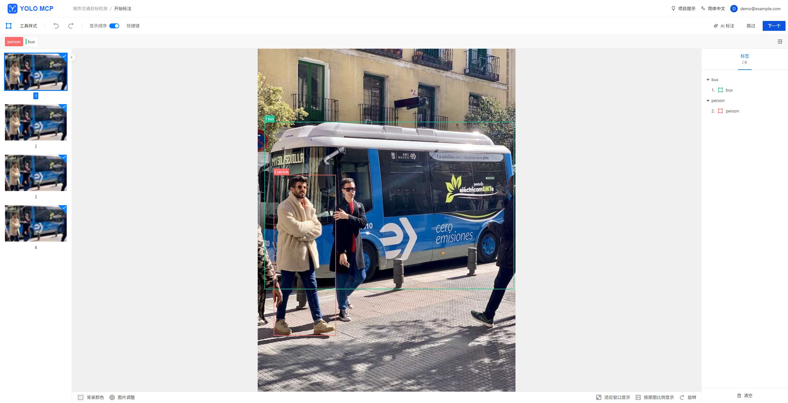

<p align="center">
  
</p>

# YOLO MCP

**在浏览器中标注图片、训练 YOLO，通过 MCP 让 AI 客户端操作同一套工作流。**

YOLO MCP 将图片管理、人工标注、AI 辅助标注和 YOLO26 目标检测训练放在一个本地应用中。你可以用网页准备数据和训练模型，也可以让支持 MCP 的 AI 客户端查询项目、上传图片、保存标注和发起训练。

[快速开始](#快速开始) · [使用流程](#使用流程) · [连接 MCP](#连接-mcp) · [文档](#文档)



## 主要功能

- **图片标注**：批量上传图片，绘制和编辑目标框，查看标注状态，划分训练集和测试集。
- **AI 辅助标注**：使用 YOLO26、Florence-2、GroundingDINO 或 SAM 3 生成候选标注，检查并保存结果。
- **YOLO26 训练**：配置初始权重和训练参数，查看训练记录、指标与日志，下载模型，继续下一轮标注。
- **MCP 工具**：让 AI 客户端操作项目、图片、标注、AI 批次和训练记录。
- **多人协作**：管理员管理账号和访问令牌，项目拥有者邀请协作者共同标注与训练。

图片、标注、模型和训练记录保存在本机，默认目录为 `~/.yolo-mcp/`。当前支持图片目标检测，训练算法为 YOLO26。

## 快速开始

需要 **Python 3.11 或更新版本**。

```bash
python -m pip install yolo-mcp
yolo-mcp --host 127.0.0.1 --port 8000
```

打开 **[http://127.0.0.1:8000](http://127.0.0.1:8000)**，按页面提示初始化管理员账号，即可创建项目并开始标注。安装包已包含网页。

训练和 AI 推理需要额外准备模型依赖及权重，见[模型与 GPU 环境](https://github.com/killf/LabelS/blob/main/backend/training/README.md#模型与-gpu-环境)。已有 CUDA 或 AMD ROCm 环境时，请在该环境中安装并启动服务。

<details>
<summary>从本地 wheel 安装</summary>

在发行包所在目录执行：

```bash
python -m pip install ./yolo_mcp-2.0.3-py3-none-any.whl
yolo-mcp --host 127.0.0.1 --port 8000
```

</details>

## 使用流程

1. **创建项目**：设置名称和标注类别。
2. **上传图片**：批量选择图片，划分训练集和测试集。
3. **完成标注**：手动绘制目标框，或选择 AI 模型生成候选框，再检查并保存。
4. **开始训练**：选择 YOLO26 初始权重，设置 Epoch 等参数并提交。
5. **使用模型**：在训练记录中查看结果、下载权重，或将产出模型用于后续 AI 标注。

开始训练时，训练集和测试集都需要至少一张已完成标注的图片。每次训练保留当时的数据快照。参数和数据格式见[训练指南](https://github.com/killf/LabelS/blob/main/backend/training/README.md)。

## 连接 MCP

先启动 YOLO MCP，在网页右上角账号菜单中打开 **“访问令牌 / MCP”**，创建个人访问令牌。

在支持 Streamable HTTP 和自定义请求头的 MCP 客户端中添加以下配置，将占位符替换为自己的令牌：

```json
{
  "mcpServers": {
    "yolo-mcp": {
      "url": "http://127.0.0.1:8000/mcp",
      "headers": {
        "Authorization": "Bearer <个人访问令牌>"
      }
    }
  }
}
```

连接后，可以这样向 AI 客户端提出请求：

> 查看项目 1 的训练集和测试集，确认是否满足训练条件。满足时，用 YOLO26s 训练 20 个 Epoch，图片尺寸 640、batch 2；随后查询训练状态和日志。

客户端会调用对应工具；训练在后台执行，可以继续查询状态。工具与网页共用用户和项目权限。更多说明见[账号、权限与 MCP](https://github.com/killf/LabelS/blob/main/backend/README.md#账号权限与-mcp)。

## 文档

| 我想…… | 查看 |
| --- | --- |
| 准备模型、使用 GPU、调整参数或离线训练 | [训练指南](https://github.com/killf/LabelS/blob/main/backend/training/README.md) |
| 配置数据目录、管理账号、远程连接 MCP | [运行与配置](https://github.com/killf/LabelS/blob/main/backend/README.md) |
| 从源码开发、运行检查或打包 | [开发与构建](https://github.com/killf/LabelS/blob/main/backend/README.md#开发与构建) |
| 使用 Docker 运行 | [Docker 部署](https://github.com/killf/LabelS/blob/main/backend/README.md#docker-部署) |
| 报告问题或提出建议 | [GitHub Issues](https://github.com/killf/LabelS/issues) |

## 致谢与许可证

YOLO MCP 基于 [LabelU](https://github.com/opendatalab/labelU)（1.5.6，8681ca4）、[LabelU-Kit](https://github.com/opendatalab/labelU-Kit/tree/v5.12.0)（v5.12.0，d06cb1f5）和 [Ultralytics](https://github.com/ultralytics/ultralytics) 开发。开放词汇标注接入参考了 [LabelU 模型服务](https://github.com/opendatalab/labelU/blob/main/model_server/README.md)，截图使用 Ultralytics 示例图片。

项目使用 [Apache-2.0 许可证](https://github.com/killf/LabelS/blob/main/LICENSE)，前端保留[上游许可证](https://github.com/killf/LabelS/blob/main/frontend/LICENSE)。第三方模型与权重遵循各自许可。
